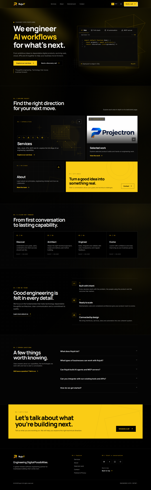
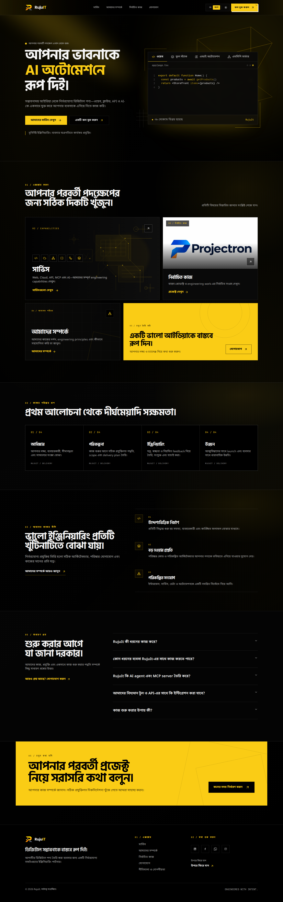
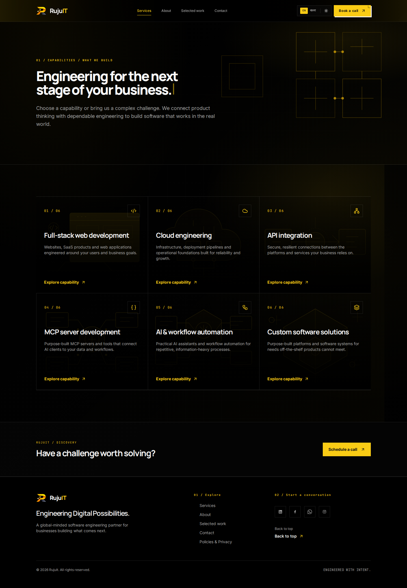
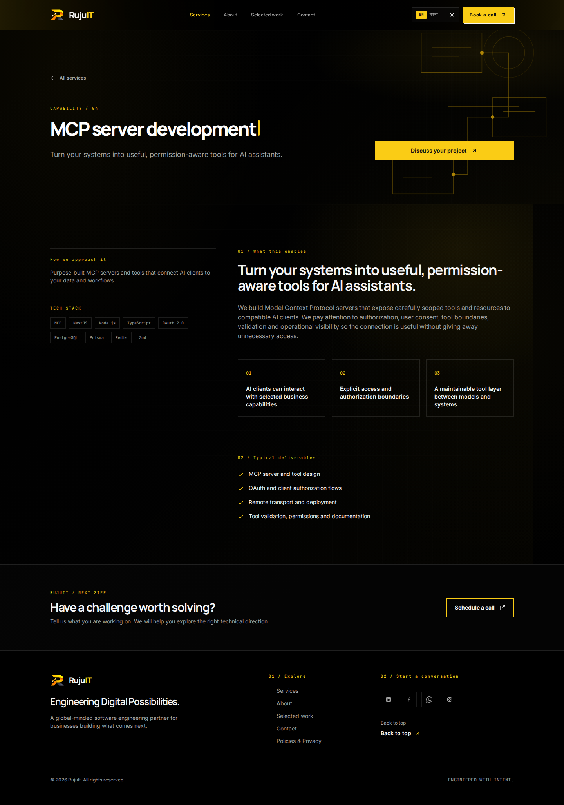
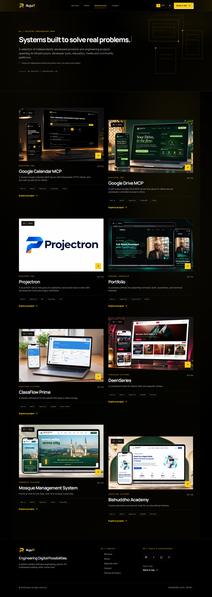
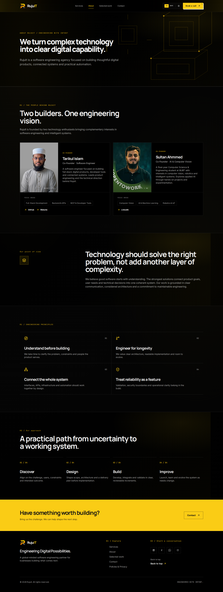
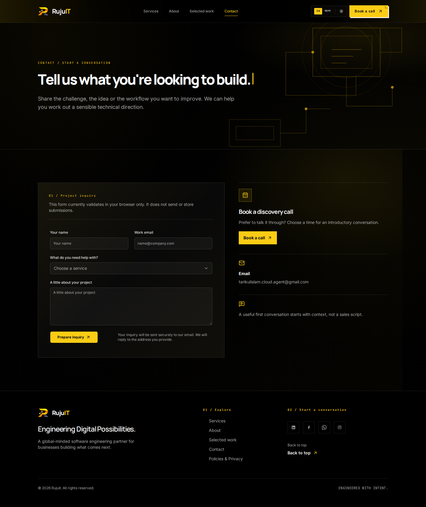
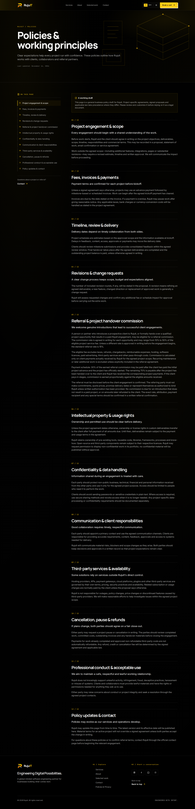

  

# RujuIT — Project Overview

**Live website:** https://rujuit.vercel.app/

RujuIT is a software engineering agency focused on thoughtful digital products, connected systems, and practical automation. The public website introduces the agency, explains its engineering capabilities, presents selected work, and provides ways to start a conversation.

## Website structure

The site is available in English (`/en`) and Bengali (`/bn`).

| Page               | Route                          | Purpose                                                                                 |
| ------------------ | ------------------------------ | --------------------------------------------------------------------------------------- |
| Home               | `/{locale}`                    | Agency introduction, capabilities, delivery approach, principles, FAQs, and contact CTA |
| Services           | `/{locale}/services`           | Overview of six engineering capabilities                                                |
| Service detail     | `/{locale}/services/{service}` | Service-specific outcomes, approach, technology stack, and deliverables                 |
| Selected work      | `/{locale}/work`               | Eight independent software and engineering projects                                     |
| About              | `/{locale}/about`              | Co-founders, engineering principles, and delivery approach                              |
| Contact            | `/{locale}/contact`            | Project inquiry and discovery-call options                                              |
| Policies & Privacy | `/{locale}/policies`           | Business engagement and working policies                                                |

### Services

1. Full-stack web development
2. Cloud engineering
3. API integration
4. MCP server development
5. AI & workflow automation
6. Custom software solutions

## How the website presents the work

The home page explains the agency and links visitors to the service, work, and about sections. The delivery approach is presented as Discover, Architect, Engineer, and Evolve. The About page introduces the two co-founders and the engineering principles behind the studio. The Selected Work page lists independent projects rather than client case studies.

The Contact page offers a project inquiry form and a discovery-call option. The live page currently notes that the form validates in the browser only and does not send or store submissions.

## Technology

The website frontend uses:

- Next.js 16
- React 19
- TypeScript
- Tailwind CSS 4
- Motion
- Radix UI
- Resend integration for email

## Live website screenshots

The screenshots below were captured from **https://rujuit.vercel.app/** on **November 15, 2026**, at a desktop viewport of 1440 pixels wide. Each page was scrolled through in viewport-sized increments to activate in-view animations and reveal animated sections. After reaching the bottom and allowing animations to settle, the page was returned to the top before taking the full-page screenshot.

### Home

### Services

### Selected work

### About

### Contact

### Policies & Privacy

